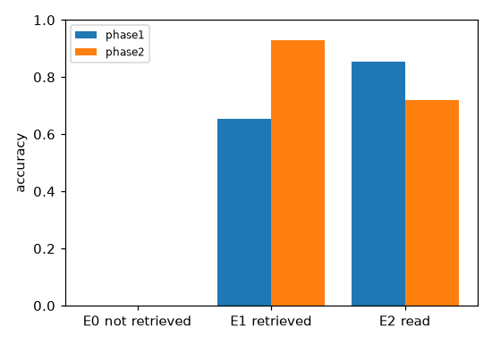
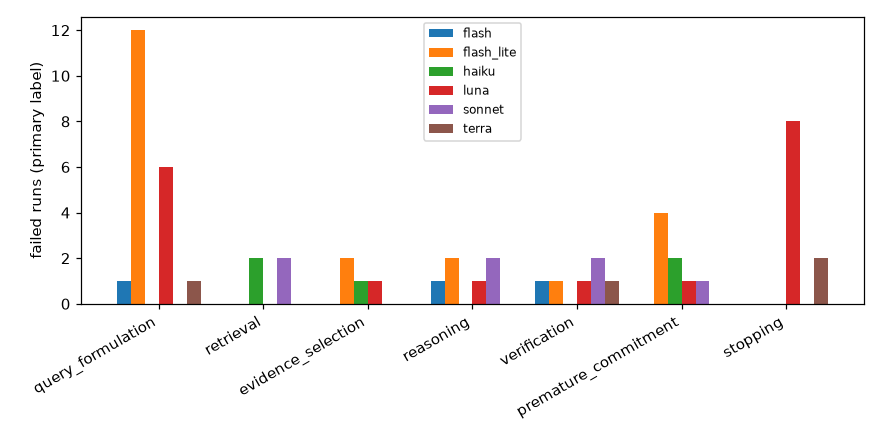

# Failure summary

Generated by `python -m src.analyze`. No question, answer, query, or document text appears here.

Labels: 58/58 failed runs reviewed (reviewer: claude-opus-5-5 (second-pass review, not human)).

## Accuracy (after the verdict check)

| group | correct | runs | accuracy |
|---|---|---|---|
| phase1 flash_lite | 9 | 30 | 0.3 |
| phase1 haiku | 25 | 30 | 0.833 |
| phase1 luna | 12 | 30 | 0.4 |
| phase2 flash | 12 | 15 | 0.8 |
| phase2 sonnet | 8 | 15 | 0.533 |
| phase2 terra | 11 | 15 | 0.733 |

| group | correct | runs | accuracy |
|---|---|---|---|
| phase1 evidence_driven | 18 | 30 | 0.6 |
| phase1 plan_execute | 12 | 30 | 0.4 |
| phase1 react | 16 | 30 | 0.533 |
| phase2 evidence_driven | 12 | 15 | 0.8 |
| phase2 plan_execute | 8 | 15 | 0.533 |
| phase2 react | 11 | 15 | 0.733 |

| group | correct | runs | accuracy |
|---|---|---|---|
| phase1 hard | 27 | 63 | 0.429 |
| phase1 moderate | 19 | 27 | 0.704 |
| phase2 hard | 19 | 27 | 0.704 |
| phase2 moderate | 12 | 18 | 0.667 |

### Verdict check

1 of 59 "incorrect" verdicts were overridden by hand (`results/review/verdict_overrides.csv`).

| group | overridden | judged_incorrect |
|---|---|---|
| phase1 flash_lite | 0 | 21 |
| phase1 haiku | 0 | 5 |
| phase1 luna | 0 | 18 |
| phase2 flash | 1 | 4 |
| phase2 sonnet | 0 | 7 |
| phase2 terra | 0 | 4 |

## Evidence exposure

E0: no evidence document retrieved · E1: retrieved, none read · E2: at least one read.

| group | correct | runs | accuracy |
|---|---|---|---|
| phase1 E0 | 0 | 30 | 0.0 |
| phase1 E1 | 17 | 26 | 0.654 |
| phase1 E2 | 29 | 34 | 0.853 |
| phase2 E0 | 0 | 6 | 0.0 |
| phase2 E1 | 13 | 14 | 0.929 |
| phase2 E2 | 18 | 25 | 0.72 |

## Failure labels

Most frequent primary labels: `query_formulation` (20), `stopping` (10), `premature_commitment` (8).

| label | phase1_primary | phase1_any | phase2_primary | phase2_any |
|---|---|---|---|---|
| query_formulation | 18 | 21 | 2 | 2 |
| retrieval | 2 | 2 | 2 | 3 |
| evidence_selection | 4 | 10 | 0 | 1 |
| evidence_utilization | 0 | 3 | 0 | 2 |
| reasoning | 3 | 3 | 3 | 3 |
| verification | 2 | 30 | 4 | 9 |
| premature_commitment | 7 | 9 | 1 | 3 |
| stopping | 8 | 30 | 2 | 6 |
| other | 0 | 0 | 0 | 0 |

## Shared failures

Mean Jaccard of label sets for same-task pairs of failed runs within a phase, against a shuffled baseline (10,000 permutations, seed 0). `same level` restricts pairs and permutations to one exposure level. `same_final_answer`: pairs giving the same wrong answer. Per-level tables: `similarity.csv`.

| phase | exposure | pair_kind | pairs | mean_jaccard | baseline | p_value | same_final_answer |
|---|---|---|---|---|---|---|---|
| phase1 | all | same agent, different model | 24 | 0.421 | 0.381 | 0.233 | 4/24 |
| phase1 | all | same model, different agent | 35 | 0.664 | 0.38 | 0.0001 | 10/35 |
| phase1 | all | neither | 49 | 0.403 | 0.382 | 0.2958 | 4/49 |
| phase1 | same level | same agent, different model | 18 | 0.465 | 0.524 | 0.8197 | 3/18 |
| phase1 | same level | same model, different agent | 28 | 0.759 | 0.523 | 0.0001 | 7/28 |
| phase1 | same level | neither | 35 | 0.454 | 0.524 | 0.932 | 4/35 |
| phase2 | all | same agent, different model | 6 | 0.556 | 0.24 | 0.0065 | 2/6 |
| phase2 | all | same model, different agent | 7 | 0.595 | 0.242 | 0.0019 | 1/7 |
| phase2 | all | neither | 13 | 0.417 | 0.24 | 0.0122 | 4/13 |
| phase2 | same level | same agent, different model | 5 | 0.567 | 0.465 | 0.1395 | 1/5 |
| phase2 | same level | same model, different agent | 5 | 0.633 | 0.463 | 0.0482 | 0/5 |
| phase2 | same level | neither | 11 | 0.432 | 0.475 | 0.8038 | 3/11 |

## Phase 1 against Phase 2 (shared tasks)

| task_id | agent | phase1_failed | phase1_primary | phase2_failed | phase2_primary | outcome |
|---|---|---|---|---|---|---|
| 286 | evidence_driven | 1/3 | evidence_selection ×1 | 0/3 | — | disappears |
| 286 | plan_execute | 0/3 | — | 1/3 | stopping ×1 | no Phase 1 failure (new in Phase 2) |
| 286 | react | 1/3 | evidence_selection ×1 | 0/3 | — | disappears |
| 366 | evidence_driven | 2/3 | query_formulation ×2 | 2/3 | query_formulation ×1; retrieval ×1 | persists |
| 366 | plan_execute | 3/3 | query_formulation ×1; retrieval ×1; stopping ×1 | 2/3 | retrieval ×1; stopping ×1 | persists |
| 366 | react | 2/3 | query_formulation ×2 | 1/3 | query_formulation ×1 | persists |
| 417 | evidence_driven | 2/3 | reasoning ×1; verification ×1 | 1/3 | reasoning ×1 | persists |
| 417 | plan_execute | 2/3 | stopping ×1; verification ×1 | 3/3 | reasoning ×2; verification ×1 | persists |
| 417 | react | 2/3 | reasoning ×2 | 2/3 | premature_commitment ×1; verification ×1 | changes |
| 580 | evidence_driven | 0/3 | — | 0/3 | — | no Phase 1 failure |
| 580 | plan_execute | 1/3 | stopping ×1 | 0/3 | — | disappears |
| 580 | react | 0/3 | — | 0/3 | — | no Phase 1 failure |
| 1233 | evidence_driven | 0/3 | — | 0/3 | — | no Phase 1 failure |
| 1233 | plan_execute | 1/3 | premature_commitment ×1 | 1/3 | verification ×1 | changes |
| 1233 | react | 1/3 | premature_commitment ×1 | 1/3 | verification ×1 | changes |

## Label agreement (Cohen's κ per label)

The second rater is a fresh-context Claude subagent, blind to the first labels; same model family, so this κ is an upper bound on reliability.

| comparison | label | runs | kappa |
|---|---|---|---|
| first vs second rater | query_formulation | 12 | 1.0 |
| first vs second rater | retrieval | 12 | 0.226 |
| first vs second rater | evidence_selection | 12 | 0.333 |
| first vs second rater | evidence_utilization | 12 | 0.625 |
| first vs second rater | reasoning | 12 | -0.0 |
| first vs second rater | verification | 12 | 1.0 |
| first vs second rater | premature_commitment | 12 | 0.625 |
| first vs second rater | stopping | 12 | 0.385 |
| first vs second rater | other | 12 | — |
| first vs second rater | (primary agrees) | 12 | 6/12 |
| first vs reviewed | query_formulation | 67 | 1.0 |
| first vs reviewed | retrieval | 67 | 1.0 |
| first vs reviewed | evidence_selection | 67 | 1.0 |
| first vs reviewed | evidence_utilization | 67 | 1.0 |
| first vs reviewed | reasoning | 67 | 0.37 |
| first vs reviewed | verification | 67 | 1.0 |
| first vs reviewed | premature_commitment | 67 | 1.0 |
| first vs reviewed | stopping | 67 | 1.0 |
| first vs reviewed | other | 67 | — |
| first vs reviewed | (primary agrees) | 67 | 59/67 |

## Controlled-evidence check

Failed E0/E1 runs rerun once with up to 3 gold documents in the first prompt.

| source_run_id | exposure | model | agent | rerun | rerun_correct |
|---|---|---|---|---|---|
| phase2-366-react-flash | E0 | flash | react | evidence-366-react-flash | yes |
| phase1-1111-evidence_driven-flash_lite | E0 | flash_lite | evidence_driven | evidence-1111-evidence_driven-flash_lite | yes |
| phase1-176-plan_execute-haiku | E1 | haiku | plan_execute | evidence-176-plan_execute-haiku | yes |
| phase1-417-plan_execute-luna | E0 | luna | plan_execute | evidence-417-plan_execute-luna | no |
| phase2-366-evidence_driven-sonnet | E0 | sonnet | evidence_driven | evidence-366-evidence_driven-sonnet | yes |
| phase2-286-plan_execute-terra | E0 | terra | plan_execute | evidence-286-plan_execute-terra | yes |
| phase1-1233-react-flash_lite | E1 | flash_lite | react | evidence-1233-react-flash_lite | yes |
| phase1-915-plan_execute-haiku | E0 | haiku | plan_execute | evidence-915-plan_execute-haiku | yes |
| phase1-833-plan_execute-luna | E0 | luna | plan_execute | evidence-833-plan_execute-luna | no |
| phase2-417-react-sonnet | E1 | sonnet | react | evidence-417-react-sonnet | yes |

## Sensitivity: Plan-and-Execute fix

The Luna and Terra Plan-and-Execute runs rerun with one added sentence saying the search tools are available during execution (`pefix` phase); the tables replace the original runs with these.

| model | original_correct | fixed_correct | runs | fixed_searched_at_all |
|---|---|---|---|---|
| luna | 1 | 3 | 10 | 6 |
| terra | 2 | 3 | 5 | 3 |

| phase | exposure | pair_kind | pairs | mean_jaccard | baseline | p_value | same_final_answer |
|---|---|---|---|---|---|---|---|
| phase1 | all | same agent, different model | 21 | 0.481 | 0.387 | 0.0557 | 3/21 |
| phase1 | all | same model, different agent | 33 | 0.795 | 0.387 | 0.0001 | 12/33 |
| phase1 | all | neither | 47 | 0.462 | 0.387 | 0.0292 | 6/47 |
| phase1 | same level | same agent, different model | 16 | 0.512 | 0.557 | 0.7616 | 2/16 |
| phase1 | same level | same model, different agent | 29 | 0.813 | 0.555 | 0.0001 | 9/29 |
| phase1 | same level | neither | 35 | 0.526 | 0.554 | 0.7302 | 6/35 |
| phase2 | all | same agent, different model | 5 | 0.7 | 0.253 | 0.0011 | 1/5 |
| phase2 | all | same model, different agent | 6 | 0.639 | 0.254 | 0.0018 | 1/6 |
| phase2 | all | neither | 11 | 0.417 | 0.254 | 0.0218 | 4/11 |
| phase2 | same level | same agent, different model | 4 | 0.75 | 0.471 | 0.0179 | 0/4 |
| phase2 | same level | same model, different agent | 4 | 0.708 | 0.471 | 0.0152 | 0/4 |
| phase2 | same level | neither | 9 | 0.444 | 0.479 | 0.7056 | 3/9 |

## Example cases

Trace outlines show event numbers and evidence documents only.

#### most shared: task 1111, phase1 (mean Jaccard 0.67, 6 failed runs)

- **phase1-1111-evidence_driven-flash_lite** · E0 · primary `query_formulation`, labels `query_formulation, stopping, verification`. the same keyword bag repeated about 30 times with tiny changes; no doc opened; forced answer names a person it had itself ruled out at #43
  - #3 search · #27 search · #39 search · #57 search · #63 search · #91 budget (tool_calls) · #93 final_answer (forced)
- **phase1-1111-evidence_driven-luna** · E0 · primary `query_formulation`, labels `query_formulation, stopping`. ledger gaps stay generic while queries guess grant amounts and groups; no evidence doc in 30 searches; declined to answer
  - #9 search · #27 search · #54 search · #57 search · #69 search · #78 search · #91 budget (tool_calls) · #93 final_answer (forced)
- **phase1-1111-plan_execute-flash_lite** · E0 · primary `query_formulation`, labels `query_formulation, stopping, verification`. near-identical amount + hobby queries for 30 calls; forced answer is a name with no support in any document read
  - #6 search · #10 search · #18 search · #24 search · #30 search · #42 search · #61 plan · #66 budget (tool_calls) · #68 final_answer (forced)
- **phase1-1111-plan_execute-luna** · E0 · primary `stopping`, labels `stopping`. gave up at the planning call (tools disabled there) without a single search
  - #2 final_answer

#### most shared: task 495, phase1 (mean Jaccard 0.67, 4 failed runs)

- **phase1-495-evidence_driven-flash_lite** · E0 · primary `query_formulation`, labels `query_formulation, stopping, verification`. about 30 searches recombining the same few clues and assuming one national TV industry; no evidence doc ever surfaced; forced answer gives a year with 'such as' and no surname
  - #3 search · #12 search · #27 search · #30 search · #48 search · #91 budget (tool_calls) · #93 final_answer (forced)
- **phase1-495-plan_execute-flash_lite** · E0 · primary `query_formulation`, labels `query_formulation, stopping, verification`. near-identical clue combinations repeated across 30 searches, never reformulated; one off-target read; forced answer leaves a placeholder for the surname
  - #4 search · #10 search · #24 search · #26 search · #34 search · #56 search · #63 budget (tool_calls) · #65 final_answer (forced)
- **phase1-495-plan_execute-luna** · E0 · primary `stopping`, labels `stopping`. gave up at the planning call (tools disabled there) without a single search
  - #2 final_answer
- **phase1-495-react-flash_lite** · E0 · primary `query_formulation`, labels `query_formulation, stopping, verification`. searches cycle over the same clue combinations; it rules out one family at #39 yet the forced answer uses that same family's surname
  - #8 search · #12 search · #22 search · #24 search · #61 budget (tool_calls) · #63 final_answer (forced)

#### most shared: task 915, phase1 (mean Jaccard 0.59, 7 failed runs)

- **phase1-915-evidence_driven-flash_lite** · E0 · primary `query_formulation`, labels `query_formulation, stopping, verification`. the same OR-lists of years and debut-phrase variants repeated about 10 times; forced answer picks a series and actress that fail the spouse clue
  - #9 search · #12 search · #15 search · #33 search · #51 search · #57 search · #72 search · #91 budget (tool_calls) · #93 final_answer (forced)
- **phase1-915-evidence_driven-luna** · E0 · primary `query_formulation`, labels `query_formulation, verification, stopping`. most searches are exact-phrase variants of one sub-clue; candidate series come from memory and are never confirmed; forced tentative guess
  - #3 search · #18 search · #30 search · #48 search · #60 search · #87 search · #90 search · #91 budget (tool_calls) · #93 final_answer (forced)
- **phase1-915-plan_execute-flash_lite** · E0 · primary `query_formulation`, labels `query_formulation, stopping, verification`. boolean OR-lists of years and phrase variants, repeated; forced answer invents a character for a guest-star role that no doc supports
  - #10 search · #20 search · #34 search · #42 search · #55 search · #66 budget (tool_calls) · #68 final_answer (forced)
- **phase1-915-plan_execute-haiku** · E0 · primary `retrieval`, labels `retrieval, stopping`. varied, sensible actor-first and series-first queries over 5 plans, but no evidence doc ever came back; tried get_document with names instead of docids; budget ran out
  - #4 search · #10 search · #54 search · #61 search · #70 budget (tool_calls) · #72 final_answer (forced)

#### most divergent: task 417, phase1 (mean Jaccard 0.34, 6 failed runs)

- **phase1-417-evidence_driven-flash_lite** · E2 · primary `reasoning`, labels `reasoning, verification, evidence_selection`. read the about page and took its nickname; the gold home page surfaced at #41 but was never opened, so the main-site nickname was never checked (the question is close to ambiguous between the two)
  - #3 search → evidence 80876 · #8 search → evidence 80876 · #11 search → evidence 80876 · #14 search → evidence 80876 · #17 search → evidence 80876 · #20 search → evidence 80876 · #29 search → evidence 80876 · #32 search → evidence 80876 · #35 search → evidence 80876 · #41 search → evidence 80876, 89624, 23599 · #44 read 89624 (evidence) · #47 search → evidence 80876 · #50 search → evidence 80876 · #53 final_answer
- **phase1-417-evidence_driven-luna** · E2 · primary `verification`, labels `verification, evidence_utilization`. read the about page, the members page and a gold page; took the about-page nickname without checking which name the main site uses for itself (question close to ambiguous)
  - #3 search → evidence 23599 · #15 search → evidence 80876 · #18 read 80876 (evidence) · #21 search → evidence 80876 · #24 search → evidence 80876 · #30 search → evidence 23599 · #33 search → evidence 89624, 23599 · #36 read 89624 (evidence) · #39 search → evidence 89624, 23599 · #45 search → evidence 89624 · #48 search → evidence 17369 · #51 read 17369 (evidence) · #54 final_answer
- **phase1-417-plan_execute-flash_lite** · E2 · primary `verification`, labels `verification, evidence_selection`. took the about-page nickname plus a spelling variant; the gold home page surfaced twice and was never opened (question close to ambiguous)
  - #6 search → evidence 80876 · #8 search → evidence 80876 · #10 search → evidence 80876 · #14 read 80876 (evidence) · #16 search → evidence 80876 · #20 search → evidence 89624 · #22 read 89624 (evidence) · #26 search → evidence 23599 · #28 search → evidence 23599 · #30 search → evidence 17369 · #32 final_answer
- **phase1-417-plan_execute-luna** · E0 · primary `stopping`, labels `stopping`. gave up at the planning call (tools disabled there) without a single search
  - #2 final_answer

#### most divergent: task 176, phase1 (mean Jaccard 0.36, 8 failed runs)

- **phase1-176-evidence_driven-flash_lite** · E1 · primary `premature_commitment`, labels `premature_commitment, evidence_selection, verification`. the gold medalists page surfaced 3 times, never opened; from #48 searches only confirm the same remembered author as the other Flash-Lite runs; forced answer unverified
  - #24 search → evidence 21744 · #42 search → evidence 21744 · #48 search · #51 search · #72 search → evidence 21744 · #78 search · #91 budget (tool_calls) · #93 final_answer (forced)
- **phase1-176-evidence_driven-haiku** · E1 · primary `evidence_selection`, labels `evidence_selection, stopping, verification`. the gold medalists page came back 8 times and was never opened, while other award lists were read; forced unverified guess
  - #4 search → evidence 21744 · #8 search → evidence 21744 · #11 search → evidence 21744 · #15 search → evidence 21744 · #19 search → evidence 21744 · #28 search → evidence 21744 · #45 search → evidence 21744 · #53 search → evidence 21744 · #63 budget (tool_calls) · #65 final_answer (forced)
- **phase1-176-plan_execute-flash_lite** · E0 · primary `premature_commitment`, labels `premature_commitment, verification, query_formulation`. same remembered author as the other Flash-Lite runs; the replan at #54 simply declares that author the answer; the co-author and 25-year clues are never checked
  - #34 search · #38 search · #42 search · #51 search · #54 plan · #56 final_answer
- **phase1-176-plan_execute-haiku** · E1 · primary `premature_commitment`, labels `premature_commitment, evidence_selection, stopping`. plans anchor on a business-journal prize, then on other named medals; the gold medalists page surfaced twice and was never opened; 7 plans, budget ran out
  - #2 plan · #4 search · #15 search → evidence 21744 · #24 plan · #46 search → evidence 21744 · #59 plan · #77 budget (tool_calls) · #79 final_answer (forced)
